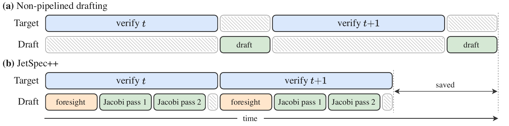
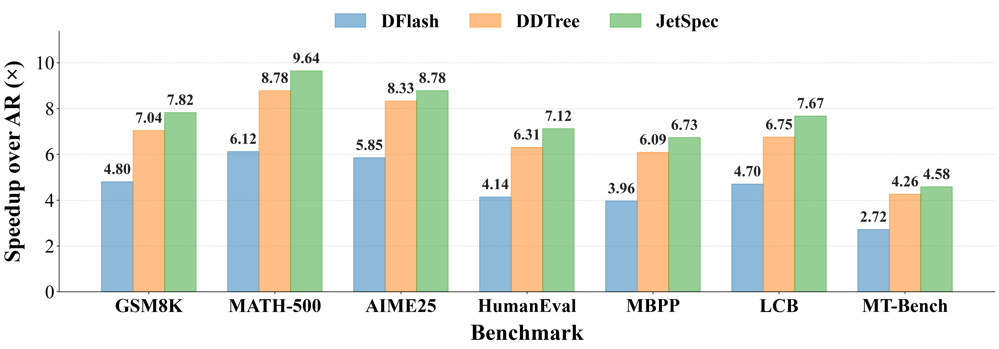
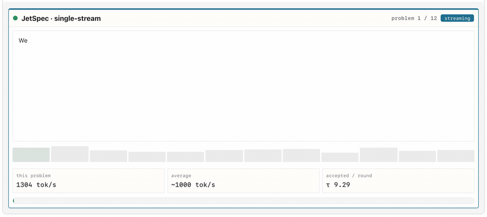

<p align="center">
  
</p>

<div align="center"><h1>JetSpec++: Foresight Parallel Drafting with Self Refinements</h1></div>

**JetSpec++** is a lossless speculative decoding method that hides drafting behind verification. The draft model runs on a second GPU, drafts the next block before the target finishes verifying the current one, and refines its draft while it waits.

<details open>
<summary><strong>JetSpec++</strong></summary>

[**Paper**](https://arxiv.org/abs/2610.19792) | [**Models**](https://huggingface.co/JetSpec)

<p align="center"></p>

<p align="center"><b>[ Demo video placeholder ]</b></p>

</details>

<details>
<summary><strong>JetSpec</strong></summary>

[**Paper**](https://arxiv.org/abs/2606.18394) | [**Blog**](https://haoailab.com/blogs/parallel-tree-decoding/) | [**Webpage**](https://jetspec-project.github.io/jetspec-web/) | [**Models**](https://huggingface.co/JetSpec)

JetSpec is an implementation of **causal parallel tree drafting** for fast LLM speculative decoding inference with up to 10x acceptance length, and 1000+ TPS on coding and math tasks using B200 GPUs. A causal-parallel draft head proposes a token tree, and the frozen target model verifies the whole tree in one forward pass under a tree-causal attention mask. The accepted path is selected in accordance with the target's own logits, so decoding is lossless by construction.

<p align="center"></p>

<p align="center"></p>

</details>

## Supported Models

| Target | Checkpoint | GPUs |
|---|---|---|
| Qwen3-8B | [`JetSpec/jetspec-plus-plus-qwen3-8b`](https://huggingface.co/JetSpec/jetspec-plus-plus-qwen3-8b) | A100, B200, GB200 |
| Qwen3.8-27B | [`JetSpec/jetspec-plus-plus-qwen3p8-27b`](https://huggingface.co/JetSpec/jetspec-plus-plus-qwen3p8-27b) | A100, B200 |

## Installation

JetSpec++ runs on Linux with two GPUs that have peer access. Install the measured environment for your platform, then the package:

```bash
git clone https://github.com/hao-ai-lab/JetSpec.git && cd JetSpec
pip install --no-deps -r jetspec/engines/jetspec_plus_plus/requirements-x86_64.lock
pip install --no-deps -e .
```

On GB200, use `requirements-gb200-aarch64.lock` with `--extra-index-url https://download.pytorch.org/whl/cu128`.

## Quick Start

```bash
python -m jetspec.engines.jetspec_plus_plus generate --model qwen3-8b \
    "How many positive whole-number divisors does 196 have?"
```

The command downloads the pinned target and checkpoint, picks the schedule for your GPU, and prints the answer with its throughput. The first run also compiles kernels into `~/.cache/jetspec-plus-plus`, which takes several minutes. `--devices` names two GPUs as `nvidia-smi` numbers them (default `0,1`).

## Evaluation

Speedup over autoregressive decoding on your GPU. `--dataset` takes `gsm8k`, `math500`, `aime25`, `humaneval`, `mbpp`, `livecodebench` or `mt-bench`:

```bash
python bench/jetspec_plus_plus/speedup.py --model qwen3-8b --dataset math500
```

The paper's Table 3 on a GB200 pair, against DSpark:

```bash
python bench/jetspec_plus_plus/table3.py --model qwen3-8b --assets release --host-values host-8b.json
python bench/jetspec_plus_plus/table3.py --model qwen3.8-27b --assets release --host-values host-27b.json
```

[`TABLE3.md`](bench/jetspec_plus_plus/TABLE3.md) describes the host file, the protocol and the other baselines.

## JetSpec

<details>
<summary><strong>Supported models, installation, quick start and evaluation for JetSpec</strong></summary>

### Supported Models

| Target family | Draft head |
|---|---|
| Qwen3-8B | [`JetSpec/jetspec-qwen3-8b`](https://huggingface.co/JetSpec/jetspec-qwen3-8b) |
| Qwen3-30B-A3B | [`JetSpec/jetspec-qwen3-30b-a3b`](https://huggingface.co/JetSpec/jetspec-qwen3-30b-a3b) |
| Qwen3.6-35B-A3B | [`JetSpec/jetspec-Qwen3.6-35B-A3B`](https://huggingface.co/JetSpec/jetspec-Qwen3.6-35B-A3B) |
| Gemma4-26B-A4B0-it | [`JetSpec/jetspec-gemma4-26B-A4B0-it`](https://huggingface.co/JetSpec/jetspec-gemma4-26B-A4B0-it) |
| GPT-OSS-20B | [`JetSpec/jetspec-gpt-oss-20b`](https://huggingface.co/JetSpec/jetspec-gpt-oss-20b) |
| Step3p7-Flash | [`JetSpec/jetspec-Step-3.7-Flash`](https://huggingface.co/JetSpec/jetspec-Step-3.7-Flash) |

Most benchmark and diagnostic scripts can read the draft head from `JETSPEC_DRAFT_HEAD`:

```bash
export JETSPEC_DRAFT_HEAD=JetSpec/jetspec-qwen3-8b
```

### Installation

```bash
pip install -e '.[bench,kernel]'
```

For FlashAttention 2 benchmarks, install the extra after build dependencies are available:

```bash
pip install -e '.[bench,flash-attn]'
```

If you use `uv`, the project includes extra build dependency metadata for `flash-attn`.

### Quick Start

JetSpec has two execution paths: `jetspec/core/`, a lightweight HuggingFace-based reference implementation, and `jetspec/engines/jetspec/`, an optimized serving engine with paged KV, custom Triton tree attention, and CUDA graphs for better wall-clock latency and throughput.

HF reference:

```python
from jetspec import LLM, SamplingParams

llm = LLM("Qwen/Qwen3-8B", attn_implementation="flash_attention_2")
out = llm.generate(
    "The three primary colors are",
    SamplingParams(temperature=0.0, max_new_tokens=64),
)
print(out["text"])
```

Inference engine, with paged KV, a Triton tree-attention backend, compiled verification, CUDA graphs, and optional session reuse:

```python
from jetspec import load_draft_head, DraftHeadTreeDrafter
from jetspec.engines.jetspec import JetSpecEngine, SamplingParams

engine = JetSpecEngine(
    "Qwen/Qwen3-8B",
    attn_backend="triton_paged_tree_compiled",
)
head = load_draft_head("JetSpec/jetspec-qwen3-8b")
drafter = DraftHeadTreeDrafter(
    head,
    target=engine.model,
    block_size=head.block_size,
    target_layer_ids=head.target_layer_ids,
)
out = engine.generate_tree(
    "The three primary colors are",
    drafter,
    block_size=head.block_size,
    tree_depth=20,
    tree_width=7,
    budget=128,
    target_layer_ids=head.target_layer_ids,
    sampling_params=SamplingParams(temperature=0.0, max_new_tokens=64),
)
print(out["text"])
print("tokens per forward:", out["tpf"])
```

### Evaluation

HF reference benchmark. With `--include-dflash-baseline`, it reports the shared AR-greedy baseline, the linear DFlash block baseline using the draft head's `block_size`, and the JetSpec tree construction algorithms selected through `--algos`:

```bash
CUDA_VISIBLE_DEVICES=0 \
JETSPEC_DRAFT_HEAD=JetSpec/jetspec-qwen3-8b \
python bench/jetspec/reference/benchmark.py \
  --model Qwen/Qwen3-8B \
  --attn-implementation flash_attention_2 \
  --tree-attn-implementation triton \
  --dataset gsm8k \
  --samples 64 \
  --algos accum_logp \
  --depth 20 \
  --width 7 \
  --budget 256 \
  --max-new 1024 \
  --warmup-rounds 3 \
  --include-dflash-baseline
```

Optimized engine, wall-clock latency and throughput. The headline throughput uses `--drafter graphed`, a CUDA-graph replay of the draft-head forward per context-capacity bucket. `--drafter eager` is correct but about 2x slower:

```bash
CUDA_VISIBLE_DEVICES=0 \
JETSPEC_FUSE_GEMMS=1 \
JETSPEC_BACKEND=triton_paged_tree_cudagraph_nogather \
JETSPEC_DRAFT_HEAD=JetSpec/jetspec-qwen3-8b \
python bench/jetspec/engine/tps_walltime.py \
  --prompt-set gsm8k \
  --samples 64 \
  --max-tokens 2048 \
  --tree-depth 20 \
  --budget 128 \
  --drafter graphed \
  --warm-all \
  --session
```

The [vLLM v1 integration](https://github.com/JetSpec-project/vllm-jetspec) supports MATH-500 testing through `examples/offline_inference/jetspec_profiling_math500_tree_budget_bsz_sweep.sh` and HumanEval testing through `examples/offline_inference/jetspec_profiling_humaneval_tree_unit_kvlayout.sh` in that checkout.

Engine results: single-stream (batch size 1) Qwen3-8B on NVIDIA B200, bf16, `--drafter graphed`, warm steady state, with a pinned CPU reservation.

| dataset | JetSpec engine TPS | accept_len |
|---|---:|---:|
| MATH-500 | **1150 tok/s** | 9.56 |
| GSM8K | **984 tok/s** | 7.94 |
| HumanEval | **867 tok/s** | 6.92 |
| AIME25 | **849 tok/s** | 8.79 |
| MBPP | **789 tok/s** | 7.61 |
| LiveCodeBench | **684 tok/s** | 7.66 |
| MT-Bench | **545 tok/s** | 4.88 |

Tree algorithms exposed by `bench/jetspec/reference/benchmark.py`:

| Algorithm | Purpose |
|---|---|
| `accum_logp` | robust breadth-first cumulative-logprob tree; default baseline |
| `top2gap_fanout` | adaptive fanout using the per-depth top-2 logprob gap |
| `task_router` | prompt/task-aware routing over tree shapes |
| `reasoning_router` | reasoning-pattern-aware routing |
| `class_histogram` | class-conditioned profile-guided tree shaping |
| `depth_rank_histogram` | offline profile table over `(depth, rank)` acceptance |

</details>

## For Coding Agents

[`AGENTS.md`](AGENTS.md) describes every command, option and component in this repository.

## Citation

```bibtex
@article{feng2026jetspecpp,
  title   = {JetSpec++: Foresight Parallel Drafting with Self Refinements},
  author  = {Feng, Zhaoxiang and Hu, Lanxiang and Yuan, Haoran and Qian, Yu-Yang and Yang, Jihui and Zhao, Peng and Zhu, Yibo and Rosing, Tajana and Zhang, Hao},
  journal = {arXiv preprint arXiv:2610.19792},
  year    = {2026}
}

@article{hu2026jetspec,
  title   = {JetSpec: Breaking the Scaling Ceiling of Speculative Decoding with Parallel Tree Drafting},
  author  = {Hu, Lanxiang and Feng, Zhaoxiang and Wu, Yulun and Yuan, Haoran and Zhao, Yujie and Qian, Yu-Yang and Wang, Bojun and Zhao, Peng and Jiang, Daxin and Zhu, Yibo and Rosing, Tajana and Zhang, Hao},
  journal = {arXiv preprint arXiv:2606.18394},
  year    = {2026}
}
```
