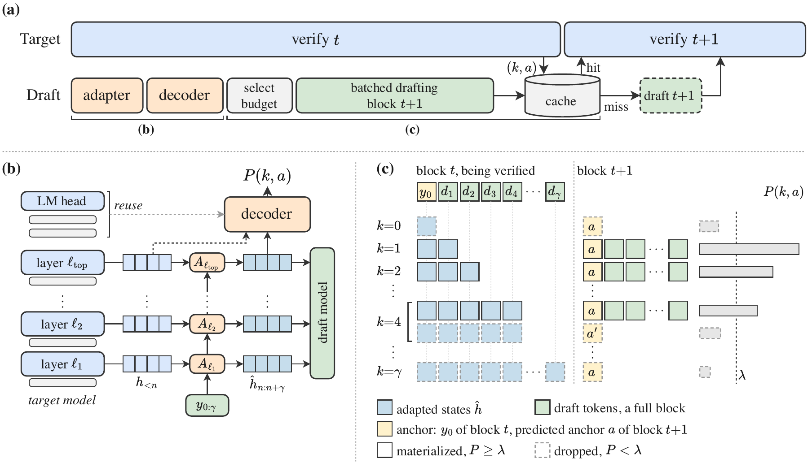

<p align="center">
  
</p>

<div align="center"><h1>JetSpec++: Foresight Parallel Drafting with Self Refinements</h1></div>

<p align="center">
  <a href="https://arxiv.org/abs/2610.19792">Paper</a> ·
  <a href="https://huggingface.co/JetSpec">Hugging Face</a> ·
  <a href="#jetspec-parallel-tree-drafting">JetSpec</a>
</p>

JetSpec++ is a lossless speculative decoding method that keeps a strong learned draft model and hides almost all of its cost. The draft model runs on a second GPU, starts the next block before the target finishes verifying the current one, and refines its own draft while it waits. For a single request on NVIDIA GB200, JetSpec++ reaches up to **7.45x** wall-clock speedup over autoregressive decoding and **1.54x** over DSpark, at up to **1,361 tokens per second**, while preserving the target model's output distribution.

<p align="center">
  
</p>

## Contents

- [Introduction](#introduction)
- [Installation](#installation)
- [Model Weights](#model-weights)
- [Repo Overview](#repo-overview)
- [Usage](#usage)
  - [Torch Reference](#torch-reference)
  - [JetSpec++ Serving Engine](#jetspec-serving-engine)
  - [Benchmarking Scripts](#benchmarking-scripts)
- [Results](#results)
- [JetSpec: Parallel Tree Drafting](#jetspec-parallel-tree-drafting)
- [Acknowledgements](#acknowledgements)
- [Citation](#citation)

## Introduction

Speculative decoding is governed by two quantities: how many drafted tokens the target accepts, and how long the draft model takes to produce them. A stronger draft model raises acceptance but adds drafting time to every round. JetSpec++ co-optimizes the two with three components:

- **Pipelined drafting and verification.** The draft model runs on its own GPU and overlaps with target verification, so drafting leaves the critical path.
- **Inter-block foresight drafting.** An adapter predicts the target's hidden states for the block under verification, a decoder scores its likely outcomes, and the draft model drafts the next block for the most probable ones before verification ends. When the realized outcome is among them, the next round starts at once. Otherwise JetSpec++ drafts a fallback block from the verified context.
- **Intra-block self refinement.** In the remaining verification time, the draft model refines its own parallel predictions with Jacobi-style passes. Between passes, a context refresh re-predicts the target states and an anchor replacement corrects the first draft token that disagrees with the decoder.

A schedule `J<j>-R<r>` runs `j` refinement passes and `r` context refreshes per round. The draft model is a causal parallel draft model built on the architecture of [JetSpec](#jetspec-parallel-tree-drafting). The target verifies every drafted block, so JetSpec++ preserves the target model's output distribution.

<p align="center">
  
</p>

## Installation

Clone the repository and install the package with the JetSpec++ torch reference:

```bash
git clone https://github.com/hao-ai-lab/JetSpec.git
cd JetSpec
pip install -e '.[jetspec-plus-plus]'
```

The serving engine runs on Linux with two CUDA GPUs that have peer access, a CUDA compiler and ninja. Install the exact measured environment for your platform, then the package, without dependency resolution. A resolved install picks other versions and can change the output tokens.

```bash
# Linux x86_64 (A100, B200)
python -m pip install --no-deps -r jetspec/engines/jetspec_plus_plus/requirements-x86_64.lock
# Linux aarch64 (GB200)
python -m pip install --no-deps -r jetspec/engines/jetspec_plus_plus/requirements-gb200-aarch64.lock \
  --extra-index-url https://download.pytorch.org/whl/cu128
python -m pip install --no-deps -e .
```

For JetSpec, see [JetSpec Installation](#jetspec-installation).

## Model Weights

JetSpec++ checkpoints are published under the [`JetSpec`](https://huggingface.co/JetSpec) Hugging Face organization. Each repository holds the draft model at its root, the adapter in `adapter/`, and the calibration in `calibration/`.

| Target | Checkpoint | Revision | Status |
|---|---|---|---|
| Qwen3-8B | [`JetSpec/jetspec-plus-plus-qwen3-8b`](https://huggingface.co/JetSpec/jetspec-plus-plus-qwen3-8b) | `9bd8b157` | shipped |
| Qwen3.8-27B | [`JetSpec/jetspec-plus-plus-qwen3p8-27b`](https://huggingface.co/JetSpec/jetspec-plus-plus-qwen3p8-27b) | `3147a351` | preview |

```bash
hf download JetSpec/jetspec-plus-plus-qwen3-8b --local-dir jspp-8b
```

The JetSpec draft heads are listed under [JetSpec Model Weights](#jetspec-model-weights).

## Repo Overview

The repository holds two methods. Each has a torch reference and an optimized engine:

```text
jetspec/
  methods/jetspec_plus_plus/   # JetSpec++ torch reference: adapter, decoder, refinement passes
  engines/jetspec_plus_plus/   # JetSpec++ serving engine: pipelined draft and verify on two GPUs
  methods/jetspec/             # JetSpec: causal parallel tree drafting
  engines/jetspec/             # JetSpec engine: paged KV, tree attention, CUDA graphs
  core/                        # shared HuggingFace reference core: LLM, ModelRunner, sampler
  models/                      # shared target loading
bench/
  jetspec_plus_plus/           # verify, tau, speedup and Table 3
  jetspec/                     # JetSpec benchmarks
```

The old import paths (`jetspec.inference_engine`, `jetspec.tree`, `jetspec.draft`, `jetspec.draft_head_adapter`) remain as compatibility shims.

## Usage

### Torch Reference

The torch reference is the readable form of the method. Point it at local copies of the target and the checkpoint:

```bash
export JETSPEC_MODEL=/path/to/Qwen3-8B
export JETSPEC_DRAFTER=jspp-8b
export JETSPEC_ADAPTER=jspp-8b/adapter
export JETSPEC_HEADS_BUNDLE=jspp-8b/calibration

python examples/jetspec_plus_plus/simple_generate.py \
  --prompt "The three primary colors are" \
  --max-tokens 64
```

It prints the generated text, the mean acceptance length, and whether the output equals plain autoregressive greedy decoding. `bench/jetspec_plus_plus/verify.py` runs the same check over a prompt set, and `bench/jetspec_plus_plus/tau.py` reads the acceptance length. The [method README](jetspec/methods/jetspec_plus_plus/README.md) lists every flag.

### JetSpec++ Serving Engine

The serving engine places the draft model on a second GPU and overlaps it with verification. Prompts are JSON rows with `index` and `token_ids`:

```bash
python -m jetspec.engines.jetspec_plus_plus \
  --model qwen3-8b \
  --target /path/to/Qwen3-8B --drafter jspp-8b \
  --adapter jspp-8b/adapter --heads-bundle jspp-8b/calibration \
  --prompts-json /path/to/prompts.json --count 8 --tokens 2048 \
  --devices 0,1 --output-json /path/to/read.json \
  --cache-root /path/to/compiler-cache
```

The engine picks its kernels and its default schedule from the GPU:

| `--model` | A100 | B200 | GB200 |
|---|---|---|---|
| `qwen3-8b` | J1-R0 | J1-R1 | J1-R1 |
| `qwen3.8-27b` (preview) | J1-R1 | J1-R1 | Table 3 command only |

Keep one `--cache-root` across reads that you compare: compiled kernels can otherwise round differently in BF16. The [engine README](jetspec/engines/jetspec_plus_plus/README.md) lists every flag.

### Benchmarking Scripts

`speedup.py` measures JetSpec++ against autoregressive decoding with CUDA graphs on the same GPU. By default it tries each supported schedule for the GPU on a few prompts, keeps the fastest, and then reads the full prompt set:

```bash
python bench/jetspec_plus_plus/speedup.py \
  --model qwen3-8b \
  --target /path/to/Qwen3-8B --drafter jspp-8b \
  --adapter jspp-8b/adapter --heads-bundle jspp-8b/calibration \
  --prompts-json /path/to/prompts.json --count 32 --tokens 2048 \
  --devices 0,1 --cache-root /path/to/compiler-cache
```

`table3.py` reproduces the paper's Table 3 on a GB200 pair, one command per model:

```bash
python bench/jetspec_plus_plus/table3.py --model qwen3-8b --assets release \
  --host-values host-8b.json --devices 0,1 --output-dir results/table3-8b
python bench/jetspec_plus_plus/table3.py --model qwen3.8-27b --assets release \
  --host-values host-27b.json --devices 0,1 --output-dir results/table3-27b
```

`--assets release` runs the JetSpec++ rows on the checkpoints above. The DSpark, DFlash and SSD rows need their own checkpoints. A full command takes roughly two to four hours. [`TABLE3.md`](bench/jetspec_plus_plus/TABLE3.md) describes the host file, the protocol and the reduction.

## Results

End-to-end decoding at batch size 1, temperature 0 and at most 2,048 tokens, on NVIDIA GB200 with CUDA graphs (the paper's Table 3). Speedup is over autoregressive decoding (AR) on one GPU of the same type, and τ is the mean number of tokens committed per verification round. SSD and JetSpec++ place their draft models on a second GPU.

**Qwen3-8B**

| Method | GSM8K tok/s | Speedup | τ | MATH-500 tok/s | Speedup | τ |
|---|---:|---:|---:|---:|---:|---:|
| AR | 182.3 | 1.00x | 1.00 | 182.7 | 1.00x | 1.00 |
| SSD | 276.5 | 1.52x | 4.06 | 282.5 | 1.55x | 4.20 |
| DFlash | 620.1 | 3.40x | 5.87 | 795.5 | 4.35x | 7.65 |
| DSpark | 744.3 | 4.08x | 7.34 | 902.1 | 4.94x | 8.98 |
| **JetSpec++** (J1-R1) | **1148.8** | **6.30x** | **7.78** | **1361.1** | **7.45x** | **9.41** |

**Qwen3.8-27B**

| Method | GSM8K tok/s | Speedup | τ | MATH-500 tok/s | Speedup | τ |
|---|---:|---:|---:|---:|---:|---:|
| AR | 60.3 | 1.00x | 1.00 | 59.3 | 1.00x | 1.00 |
| DSpark | 249.6 | 4.14x | 7.93 | 279.8 | 4.72x | 8.99 |
| **JetSpec++** (J3-R3) | **342.4** | **5.68x** | **9.67** | **367.2** | **6.20x** | **10.45** |

On our GB200 pair, `table3.py` reproduces every row within 3.4% in tokens per second and 1.6% in τ. The 27B preview checkpoint uses a more general adapter than the paper's 27B rows. [`RESULTS.md`](bench/jetspec_plus_plus/RESULTS.md) has the released checkpoints on A100, B200 and GB200.

## JetSpec: Parallel Tree Drafting

<p align="center">
  <a href="https://jetspec-project.github.io/jetspec-web/">Project Webpage</a> ·
  <a href="https://arxiv.org/pdf/2606.18394">Paper</a> ·
  <a href="https://haoailab.com/blogs/parallel-tree-decoding/">Blog</a>
</p>

JetSpec is an implementation of **causal parallel tree drafting** for fast LLM speculative decoding inference with up to 10x acceptance length, and 1000+ TPS on coding and math tasks using B200 GPUs. A causal-parallel draft head proposes a token tree, and the frozen target model verifies the whole tree in one forward pass under a tree-causal attention mask. The accepted path is selected in accordance with the target's own logits, so decoding is lossless by construction.

<p align="center">
  
</p>

Speculative decoding is fast when the target accepts many draft tokens and drafting remains cheap. Prior heads often trade off those two terms: autoregressive drafters condition on each path but pay a forward pass per depth, while block-diffusion drafters draft many positions in one pass but score branches independently.

JetSpec keeps the **one-pass drafting efficiency and restores causal branch conditioning**. The draft head reads fused hidden states from the frozen target and emits per-depth logits in a single parallel pass. Tree construction spends a draft budget over high-probability branches, and the target verifies every node in one batched/tree-masked forward.

On Qwen3-8B evaluations, JetSpec reaches up to **9.64x end-to-end speedup on MATH-500**, with strong gains across reasoning, code, and chat workloads: 7.82x on GSM8K, 8.78x on AIME25, 7.12x on HumanEval, 6.73x on MBPP, 7.67x on LCB, and 4.58x on MT-Bench.

<p align="center">
  
</p>

### JetSpec Installation

```bash
pip install -e '.[bench,kernel]'
```

For FlashAttention 2 benchmarks, install the extra after build dependencies are available:

```bash
pip install -e '.[bench,flash-attn]'
```

If you use `uv`, the project includes extra build dependency metadata for `flash-attn`.

### JetSpec Model Weights

JetSpec draft heads are published under the [`JetSpec`](https://huggingface.co/JetSpec) Hugging Face organization.

| Target family | Draft head |
|---|---|
| Qwen3-8B | [`JetSpec/jetspec-qwen3-8b`](https://huggingface.co/JetSpec/jetspec-qwen3-8b) |
| Qwen3-30B-A3B | [`JetSpec/jetspec-qwen3-30b-a3b`](https://huggingface.co/JetSpec/jetspec-qwen3-30b-a3b) |
| Qwen3.6-35B-A3B | [`JetSpec/jetspec-Qwen3.6-35B-A3B`](https://huggingface.co/JetSpec/jetspec-Qwen3.6-35B-A3B) |
| Gemma4-26B-A4B0-it | [`JetSpec/jetspec-gemma4-26B-A4B0-it`](https://huggingface.co/JetSpec/jetspec-gemma4-26B-A4B0-it) |
| GPT-OSS-20B | [`JetSpec/jetspec-gpt-oss-20b`](https://huggingface.co/JetSpec/jetspec-gpt-oss-20b) |
| Step3p7-Flash | [`JetSpec/jetspec-Step-3.7-Flash`](https://huggingface.co/JetSpec/jetspec-Step-3.7-Flash) |

Most benchmark and diagnostic scripts can read the draft head from `JETSPEC_DRAFT_HEAD`:

```bash
export JETSPEC_DRAFT_HEAD=JetSpec/jetspec-qwen3-8b
```

### JetSpec Usage

JetSpec has two execution paths: `jetspec/core/`, a lightweight HuggingFace-based reference implementation, and `jetspec/engines/jetspec/`, an optimized serving engine with paged KV, custom Triton tree attention, and CUDA graphs for better wall-clock latency and throughput.

#### HF References

```python
from jetspec import LLM, SamplingParams

llm = LLM("Qwen/Qwen3-8B", attn_implementation="flash_attention_2")
out = llm.generate(
    "The three primary colors are",
    SamplingParams(temperature=0.0, max_new_tokens=64),
)
print(out["text"])
```

#### JetSpec Inference Engine

The optimized engine uses paged KV, a Triton tree-attention backend, compiled verification, CUDA graphs, and optional session reuse.

```python
from jetspec import load_draft_head, DraftHeadTreeDrafter
from jetspec.engines.jetspec import JetSpecEngine, SamplingParams

engine = JetSpecEngine(
    "Qwen/Qwen3-8B",
    attn_backend="triton_paged_tree_compiled",
)
head = load_draft_head("JetSpec/jetspec-qwen3-8b")
drafter = DraftHeadTreeDrafter(
    head,
    target=engine.model,
    block_size=head.block_size,
    target_layer_ids=head.target_layer_ids,
)
out = engine.generate_tree(
    "The three primary colors are",
    drafter,
    block_size=head.block_size,
    tree_depth=20,
    tree_width=7,
    budget=128,
    target_layer_ids=head.target_layer_ids,
    sampling_params=SamplingParams(temperature=0.0, max_new_tokens=64),
)
print(out["text"])
print("tokens per forward:", out["tpf"])
```

#### JetSpec Benchmarking Scripts

The benchmark examples below use `Qwen/Qwen3-8B` with drafter `JetSpec/jetspec-qwen3-8b`.

HF reference benchmark:

```bash
CUDA_VISIBLE_DEVICES=0 \
JETSPEC_DRAFT_HEAD=JetSpec/jetspec-qwen3-8b \
python bench/jetspec/reference/benchmark.py \
  --model Qwen/Qwen3-8B \
  --attn-implementation flash_attention_2 \
  --tree-attn-implementation triton \
  --dataset gsm8k \
  --samples 64 \
  --algos accum_logp \
  --depth 20 \
  --width 7 \
  --budget 256 \
  --max-new 1024 \
  --warmup-rounds 3 \
  --include-dflash-baseline
```

With `--include-dflash-baseline`, the HF reference benchmark reports the shared AR-greedy baseline, the linear DFlash block baseline using the draft head's `block_size`, and the selected JetSpec tree construction algorithms through `--algos`.

Optimized JetSpec engine with wall-clock latency and throughput benchmarking.
The headline throughput uses `--drafter graphed` — a CUDA-graph replay of the
draft-head forward, per context-capacity bucket. At batch size 1 the tree round is
host-launch-bound, so graphing the draft head (like the verify stack) is what reaches
the engine-results numbers; `--drafter eager` is correct but ~2x slower:

```bash
CUDA_VISIBLE_DEVICES=0 \
JETSPEC_FUSE_GEMMS=1 \
JETSPEC_BACKEND=triton_paged_tree_cudagraph_nogather \
JETSPEC_DRAFT_HEAD=JetSpec/jetspec-qwen3-8b \
python bench/jetspec/engine/tps_walltime.py \
  --prompt-set gsm8k \
  --samples 64 \
  --max-tokens 2048 \
  --tree-depth 20 \
  --budget 128 \
  --drafter graphed \
  --warm-all \
  --session
```

Run [`our vLLM v1 integration with JetSpec support`](https://github.com/JetSpec-project/vllm-jetspec) on MATH-500 for performance test:

```bash
VLLM_FORK_DIR=/path/to/vllm-jetspec
TARGET_MODEL=/path/to/Qwen3-30B-A3B
DRAFT_MODEL=/path/to/jetspec-draft-head
PROFILER_DIR=/path/to/output/jetspec-math500
TP_SIZE=4
BATCH_SIZE=1
MAX_TREE_BUDGET=128
MAX_TOKENS=512
MAX_SAMPLES=16

cd "${VLLM_FORK_DIR}"
GPU_MEMORY_UTILIZATION="${GPU_MEMORY_UTILIZATION:-0.90}" \
bash "${VLLM_FORK_DIR}/examples/offline_inference/jetspec_profiling_math500_tree_budget_bsz_sweep.sh" \
  --model "${TARGET_MODEL}" \
  --draft-model "${DRAFT_MODEL}" \
  --profiler-dir "${PROFILER_DIR}" \
  --tree-attn-kernel triton \
  --enable-expert-parallel \
  --disable-cascade-attn \
  --cudagraph-mode default \
  --tp-size "${TP_SIZE}" \
  --batch-sizes "${BATCH_SIZE}" \
  --max-num-seqs "${BATCH_SIZE}" \
  --tree-budgets "${MAX_TREE_BUDGET}" \
  --max-tokens "${MAX_TOKENS}" \
  --max-samples "${MAX_SAMPLES}" \
  --num-warmup-runs 1 \
  --profiler none \
  --max-model-len 3072 \
  --max-num-batched-tokens 16384
```

These scripts belong to the external vLLM integration checkout. The [`vLLM integration`](https://github.com/JetSpec-project/vllm-jetspec) supports MATH-500 testing through the command above and HumanEval testing through `${VLLM_FORK_DIR}/examples/offline_inference/jetspec_profiling_humaneval_tree_unit_kvlayout.sh`.

### JetSpec Engine Results

The optimized engine runs single-stream (batch size 1) Qwen3-8B tree-speculative decoding with paged KV and CUDA-graph verification. NVIDIA B200, bf16, the production configuration below (`--drafter graphed`, warm steady-state), with a pinned CPU reservation so the host-bound batch-1 round is reproducible. These closely align with the [`vLLM v1 integration`](https://github.com/JetSpec-project/vllm-jetspec).

| dataset | JetSpec engine TPS | accept_len |
|---|---:|---:|
| MATH-500 | **1150 tok/s** | 9.56 |
| GSM8K | **984 tok/s** | 7.94 |
| HumanEval | **867 tok/s** | 6.92 |
| AIME25 | **849 tok/s** | 8.79 |
| MBPP | **789 tok/s** | 7.61 |
| LiveCodeBench | **684 tok/s** | 7.66 |
| MT-Bench | **545 tok/s** | 4.88 |

### Tree Algorithms

Common algorithms exposed by `bench/jetspec/reference/benchmark.py`:

| Algorithm | Purpose |
|---|---|
| `accum_logp` | robust breadth-first cumulative-logprob tree; default baseline |
| `top2gap_fanout` | adaptive fanout using the per-depth top-2 logprob gap |
| `task_router` | prompt/task-aware routing over tree shapes |
| `reasoning_router` | reasoning-pattern-aware routing |
| `class_histogram` | class-conditioned profile-guided tree shaping |
| `depth_rank_histogram` | offline profile table over `(depth, rank)` acceptance |

## Acknowledgements

JetSpec and JetSpec++ build on code from causal_parallel_drafting (MIT), vLLM (Apache 2.0), SSD (MIT), DeepSpec (MIT) and FlashInfer (BSD-3-Clause). The attributions are in [`jetspec/THIRD_PARTY_NOTICES`](jetspec/THIRD_PARTY_NOTICES).

## Citation

```bibtex
@article{feng2026jetspecpp,
  title = {JetSpec++: Foresight Parallel Drafting with Self Refinements},
  author = {Feng, Zhaoxiang and Hu, Lanxiang and Yuan, Haoran and Qian, Yu-Yang and Yang, Jihui and Zhao, Peng and Zhu, Yibo and Rosing, Tajana and Zhang, Hao},
  journal = {arXiv preprint arXiv:2610.19792},
  year = {2026},
  url = {https://arxiv.org/abs/2610.19792},
  eprint = {2610.19792},
  note = {Preprint}
}

@article{hu2026jetspec,
  title = {JetSpec: Breaking the Scaling Ceiling of Speculative Decoding with Parallel Tree Drafting},
  author = {Hu, Lanxiang and Feng, Zhaoxiang and Wu, Yulun and Yuan, Haoran and Zhao, Yujie and Qian, Yu-Yang and Wang, Bojun and Zhao, Peng and Jiang, Daxin and Zhu, Yibo and Rosing, Tajana and Zhang, Hao},
  journal = {arXiv preprint arXiv:2606.18394},
  year = {2026},
  url = {https://arxiv.org/abs/2606.18394},
  eprint = {2606.18394},
  note = {Preprint}
}
```
