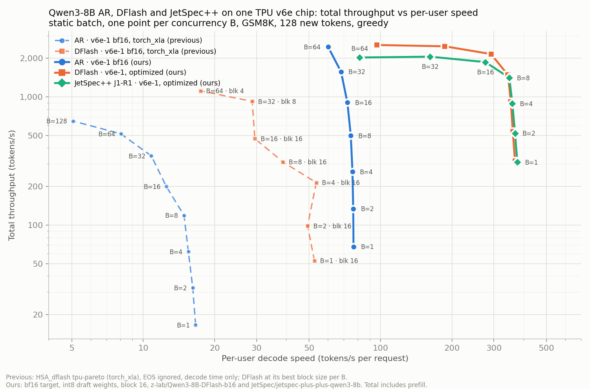
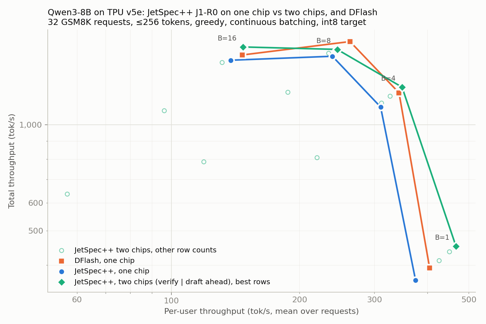

# JetSpec++ on TPU

A JAX port of JetSpec++ for Qwen3-8B on a single TPU chip (developed on a v6e-1, 32 GB HBM), and a
two-chip variant that drafts on one chip while the other verifies (v5e, below).
The output is the target's greedy decode. The drafter, adapter and anchor decoder follow the torch
reference in `jetspec/engines/jetspec_plus_plus/draft/` (`reference/round.py`, `method/adapter.py`,
`method/decoder/`).

```bash
pip install --no-deps -e .            # plus jax[tpu], safetensors, transformers, huggingface_hub
python -m jetspec.engines.jetspec_plus_plus_tpu "How many positive whole-number divisors does 196 have?" --check-ar
python -m jetspec.engines.jetspec_plus_plus_tpu.bench --dataset gsm8k --samples 32 --max-tokens 2048 \
    --schedules J1-R1,J1-R0,J0-R0 --output out/gsm8k.json
```

Both commands download the pinned `Qwen/Qwen3-8B` target and the `JetSpec/jetspec-plus-plus-qwen3-8b`
checkpoint, as the CUDA engine does. Compiled programs are kept in `~/.cache/jetspec-plus-plus-tpu/xla`
(`JETSPEC_TPU_XLA_CACHE`).

## Measured results (v6e-1)

Qwen3-8B, batch 1, temperature 0, 32 prompts per dataset, at most 2048 tokens, EOS stopping,
int8 draft unless noted. AR is the same JAX target code decoding one token per step.

| Dataset | AR tok/s | Schedule | τ | ms/round | tok/s | Speedup |
|---|---:|---|---:|---:|---:|---:|
| GSM8K | 68.9 | **J1-R1** | 8.44 | 20.17 | **418.6** | **6.08x** |
| GSM8K | | J1-R0 | 6.81 | 17.04 | 399.9 | 5.81x |
| GSM8K | | J0-R0 | 5.79 | 15.46 | 374.7 | 5.44x |
| GSM8K | | J1-R1, bf16 draft | 8.51 | 26.44 | 321.7 | 4.67x |
| MATH-500 | 71.0 | **J1-R1** | 10.45 | 20.22 | **517.0** | **7.29x** |
| MATH-500 | | J1-R0 | 8.97 | 17.13 | 523.9 | 7.38x |
| MATH-500 | | J0-R0 | 8.08 | 15.53 | 520.2 | 7.33x |
| MATH-500 | | J1-R1, bf16 draft | 10.47 | 26.41 | 396.4 | 5.58x |

Per round, the bf16 target verify of 16 tokens takes about 13.9 ms, which is the floor. A drafter pass
takes about 1.5 ms in int8 (2.85 ms in bf16), and a refresh (adapter and decoder) about 3 ms in int8 (6 ms in bf16).

Equality with AR: J1-R1 matched AR on 19/32 GSM8K and 14/32 MATH-500 outputs. All 31 divergences
were checked. In every one, the AR token and the JetSpec++ token are the target's top 2, with a logit
gap of 0.001 to 0.13, about one bf16 step at that logit size. The cause is bf16 rounding, not the draft.

## Serving frontier: AR vs DFlash vs JetSpec++ (v6e-1)

`serve.py` batches B requests in one compiled round, mapped over the slots with `vmap`, and refills
slots as requests finish (continuous batching). DFlash (`z-lab/Qwen3-8B-DFlash-b16`) runs in the
same harness: one bidirectional drafter pass over [anchor, mask x 15]. The target code, caches and
int8 draft weights are the same for every method.

```bash
for m in ar dflash jetspec; do
  python -m jetspec.engines.jetspec_plus_plus_tpu.pareto --method $m --slots 1,2,4,8,16,32 \
      --requests 128 --max-tokens 1024 --output out/$m.json
done
python -m jetspec.engines.jetspec_plus_plus_tpu.plot_pareto out/ar.json out/dflash.json out/jetspec.json \
    --output out/pareto.png
```


GSM8K, 128 requests, at most 1024 tokens, greedy. Total tok/s includes prefills. Per-user tok/s is
each request's tokens over the time from its admission to its last token, averaged over requests.

| B | AR total / per-user | DFlash total / per-user (τ 6.4) | JetSpec++ J1-R1 total / per-user (τ 8.4) | J1-R0 total (τ 6.7) | J0-R0 total (τ 5.8) |
|---:|---:|---:|---:|---:|---:|
| 1 | 69 / 69 | **377 / 390** | 376 / 384 | 351 | 341 |
| 2 | 138 / 69 | **761 / 393** | 756 / 387 | 723 | 684 |
| 4 | 268 / 68 | **1411 / 368** | 1387 / 358 | 1331 | 1279 |
| 8 | 509 / 65 | **2377 / 318** | 2245 / 297 | 2251 | 2141 |
| 16 | 893 / 59 | **3253 / 226** | 2898 / 199 | 3079 | 3008 |
| 32 | 1402 / 51 | **3394 / 141** | 2929 / 114 | 3307 | 3240 |
| 64 | 1561 / 42 | | | | |

On one chip, **DFlash is on the frontier at every concurrency**. At B=1 JetSpec++ J1-R1 ties it.
At B=16 and above the refinement passes become compute-bound, and JetSpec++ falls 10 to 14% behind.
JetSpec++ accepts more tokens per round (τ 8.4 vs 6.4), but each J or R pass is another full sweep
of the draft weights. The two-GPU method hides that cost behind verification; one chip cannot. Both
speculative methods beat AR by 2.2 to 5.5x in total throughput and by 3.4 to 5.6x per user.

Losslessness: every output was compared with AR at B=1. Each one is either identical or first
diverges where the two tokens are the target's top 2 (logit gap of at most 0.33). AR at B=2 already
diverges from AR at B=1 on 41 of 128 requests in the same way, so batch shape alone flips these bf16 ties.

### Against the same algorithms in PyTorch on torch_tpu



Dashed: the batched AR / DFlash code of
[HSA_dflash, branch tpu-pareto](https://github.com/haorany7/HSA_dflash/tree/tpu-pareto) (`dflash/batched_xla.py`,
HF Qwen3 + DFlash, bf16), run on torch_tpu 0.2 with both model forwards under
`torch.compile(backend="tpu", dynamic=False)`. Solid: this engine (JAX, int8 draft weights). Both use the same
GSM8K prompts, static batches of B prompts (at least 32 requests per point), 128 new tokens, greedy, DFlash block
16. Per-user is decode tok/s per request; total includes prefill. Data: `assets/frontier_static128_v6e.json`.

| B | AR, torch_tpu | AR (ours) | DFlash, torch_tpu | DFlash (ours) | JetSpec++ J1-R1 (ours) |
|---:|---:|---:|---:|---:|---:|
| 1 | 62 / 66 | 68 / 77 | 162 / 189 | 316 / 368 | 309 / 377 |
| 4 | 197 / 59 | 261 / 76 | 229 / 71 | 916 / 354 | 887 / 359 |
| 16 | 363 / 33 | 906 / 72 | 246 / 19 | 2158 / 292 | 1868 / 277 |
| 32 | 361 / 17 | 1571 / 68 | 218 / 9 | 2480 / 187 | 2060 / 162 |
| 64 | 383 / 9 | 2457 / 60 | OOM | 2540 / 96 | 2029 / 82 |

Each cell is total / per-user tok/s. At B=1 the compiled PyTorch AR is within 15% of ours (15.3 vs 13.0 ms
per step), and its DFlash accepts as many tokens (tau 5.4) at 1.9x our round time. Its step time grows almost
linearly with B (AR 15 to 107 ms from B=1 to 64, DFlash 28 to 460 ms from B=1 to 32), so DFlash peaks at about
250 tok/s in total and runs out of HBM at B=64. Ours stays at 13 to 17 ms per AR step up to B=64.
JetSpec++ leads DFlash per user by 1-2% up to B=8 and trails it by 13-20% from B=16, where the extra
refinement passes become compute-bound.

## Two chips: one verifies while the other drafts ahead (v5e)

With a second chip the method gets back what the two-GPU engine has: drafting overlaps verification.
`foresight.py` (B = 1) and `foresight_serve.py` (continuous batching, every program `vmap`-ed over the slots)
split each round across two chips:

```
chip 0: verify block t (16 tokens per slot) -> acceptance, correction, taps
chip 1: resolve   look up (acceptance, correction) among the rows drafted last round; on a miss, redraft
                  from the exact context (missed slots only, `group` at a time)
        foresight exact taps -> drafter / adapter caches; adapter predicts block t's states; anchor decoder
                  scores the (accepted length k, next token a) outcomes; the top `rows` outcomes each draft
                  block t+1 from exact[<L] + predicted[L..L+k], while chip 0 verifies
```

Verification is unchanged, so the output is still the target's greedy decode; only the time per round moves.
`--exact-tail` runs the adapter once over the block from the exact prefix (16 positions) instead of once per
row with the row's tail (32 positions), which matters at large B.

```bash
python -m jetspec.engines.jetspec_plus_plus_tpu.foresight_pareto --slots 1,4,8,16 --rows 1,2,4,8 --group 4 \
    --exact-tail --int8-target --requests 32 --max-tokens 256 --output out/fsp_exact.json
python -m jetspec.engines.jetspec_plus_plus_tpu.pareto --method dflash --slots 1,4,8,16 --int8-target \
    --requests 32 --max-tokens 256 --output out/dflash_v5e.json
python -m jetspec.engines.jetspec_plus_plus_tpu.plot_two_chip out/fsp_exact.json --baseline out/dflash_v5e.json \
    --output out/frontier_two_chip_v5e.png
```



TPU v5e (16 GB HBM per chip, so the target's layers are weight-only int8 with `--int8-target`), J1-R0,
32 GSM8K requests, at most 256 tokens, greedy, continuous batching. Two chips use chips 0 and 1; the one-chip
baseline (`serve.py`) runs on a third chip of the same host. DFlash runs on one chip with the same requests
and int8 target. Data: `assets/frontier_two_chip_v5e.json`. Cells are per-user / total tok/s.

| B | DFlash, one chip (τ 6.0) | JetSpec++, one chip (τ 6.5) | JetSpec++, two chips (τ 6.3-6.5) | Rows | Two chips vs one-chip JetSpec++ | Two chips vs DFlash |
|---:|---:|---:|---:|---:|---:|---:|
| 1 | 404 / 393 | 375 / 362 | **467 / 452** | 8 | +25% / +25% | +15% / +15% |
| 4 | 343 / 1233 | 310 / 1124 | **348 / 1280** | 2 | +12% / +14% | +2% / +4% |
| 8 | **263 / 1724** | 239 / 1566 | 245 / 1638 | 1 | +3% / +5% | −7% / −5% |
| 16 | 147 / 1579 | 138 / 1526 | **147 / 1664** | 1 | +7% / +9% | 0% / +5% |

On one v5e chip, as on v6e, DFlash leads JetSpec++ at every B. The second chip moves JetSpec++ ahead of
one-chip DFlash at B = 1 (+15% per user), roughly level at B = 4 and 16, and still behind at B = 8. These
comparisons give JetSpec++ two chips against DFlash's one: per chip, DFlash serves about twice the total.

The gain is largest at B=1, where the draft chip is idle during verify. As B grows, the best number of rows
falls to 1, and the gain shrinks: for Qwen3-8B the drafter, adapter and decoder together cost about as much
compute per round as the target's verify, so chip 1 becomes the bottleneck (at B=16, before `--exact-tail`,
foresight took 40 ms per round against 27 ms for verify). Without `--exact-tail` the two-chip
engine reached 217 / 1449 (B=8) and 120 / 1382 (B=16), below one chip. A larger target makes the draft side
relatively cheaper, which is where a separate draft chip pays most.

Equality: 22 to 26 of 32 two-chip outputs per point are identical to the one-chip run. We have not yet checked
whether the divergent ones at B > 1 are near-ties of the target, as the bf16 divergences above are
(`foresight_divcheck.py` does this check at B = 1).

## How one chip changes the method

The two-GPU engine hides drafting behind verification. While block t verifies, the draft GPU
pre-drafts block t+1 for up to sixteen (accepted length, anchor) outcomes. A single chip runs one
program at a time, so those rows have nowhere to hide. A hit row is also drafted from
adapter-predicted context, whereas the reference's miss path drafts from the exact verified context.
So each round here is one compiled program:

```
verify block t (target, 16 tokens) -> accept -> cache the accepted taps
  -> draft block t+1 from the exact context with the J/R schedule
```

The draft is `RoundDriver.run(admission=True)` under `JetSpecPPConfig.paper_eval`: J passes of the
drafter, then R refreshes. A refresh runs the adapter, then the anchor decoder (target layers 34-35, the
final norm and the LM head), then the margin-0 anchor swap with agreed pins. Frozen converged
passes are kept. On the same inputs, the TPU draft matches the torch reference token for token (J0, the swap and
the final block). The adapter-predicted taps agree to a cosine of at least 0.9999.

## What makes it fast

Batch-1 decoding is bound by HBM bandwidth. On this chip, XLA streams weights at about 1.1 TB/s,
and a plain reduction over the weights reaches the same rate. So the work is mostly about bytes:

- **One program per round.** Verify, acceptance, the cache writes and the next draft run with no host
  sync between them. The host reads round r only after it has dispatched round r+1.
- **Incremental context caches.** The reference re-projects the whole context on every pass. Here
  every projection that depends only on committed positions is cached once: the drafter's context
  K/V (5 layers), the adapter's prefix K/V (12 stream layers) and the decoder's layer-34/35 K/V. The
  last of these are the target's own KV cache rows, because the decoder is that slice of the target.
- **Head-major caches** (`[layer, kv_head, seq, dim]`). This is the layout the TPU attention uses, so
  XLA never copies a cache between layouts. That copy cost about 3.5 ms per round.
- **New K/V written after the layer scan.** The target attends to [cached prefix | new block], so
  the cache stays loop-invariant inside the scan.
- **Weight-only int8 on the draft side** (`--draft-dtype int8`, the default): the drafter, the adapter
  and draft copies of the decoder layers and the LM head. The target that verifies stays bf16, so the
  output does not change; only acceptance can move.
- **Span buckets** (512, 1024, 2048, …). All of them are compiled before timing starts.

## Notes

- Qwen3.8-27B does not fit: its bf16 weights alone need about 54 GB.
- Greedy JetSpec++ output can differ from greedy AR output in bf16. In every divergence we checked, the two
  tokens were the target's top 2, with a logit gap of 0.01 to 0.08. The 1-token AR forward and the
  16-token verify forward round differently. `AGENTS.md` reports the same effect for the CUDA engine.
- Throughput counts decode time only, without prefill or the first draft, as the paper does. The clock stops when
  the last needed round is read, for both AR and JetSpec++.
