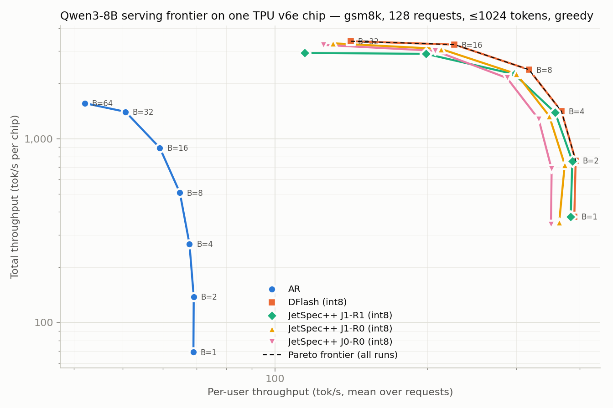

# JetSpec++ on one TPU chip

A JAX port of JetSpec++ for Qwen3-8B on a single TPU chip (developed on a v6e-1, 32 GB HBM).
The output is the target's greedy decode. The drafter, adapter and anchor decoder follow the torch
reference in `jetspec/methods/jetspec_plus_plus/`.

```bash
pip install --no-deps -e .            # plus jax[tpu], safetensors, transformers, huggingface_hub
python -m jetspec.engines.jetspec_plus_plus_tpu "How many positive whole-number divisors does 196 have?" --check-ar
python -m jetspec.engines.jetspec_plus_plus_tpu.bench --dataset gsm8k --samples 32 --max-tokens 2048 \
    --schedules J1-R1,J1-R0,J0-R0 --output out/gsm8k.json
```

Both commands download the pinned `Qwen/Qwen3-8B` target and the `JetSpec/jetspec-plus-plus-qwen3-8b`
checkpoint, as the CUDA engine does. Compiled programs are kept in `~/.cache/jetspec-plus-plus-tpu/xla`
(`JETSPEC_TPU_XLA_CACHE`).

## Measured results (v6e-1)

Qwen3-8B, batch 1, temperature 0, 32 prompts per dataset, at most 2048 tokens, EOS stopping,
int8 draft unless noted. AR is the same JAX target code decoding one token per step.

| Dataset | AR tok/s | Schedule | τ | ms/round | tok/s | Speedup |
|---|---:|---|---:|---:|---:|---:|
| GSM8K | 68.9 | **J1-R1** | 8.44 | 20.17 | **418.6** | **6.08x** |
| GSM8K | | J1-R0 | 6.81 | 17.04 | 399.9 | 5.81x |
| GSM8K | | J0-R0 | 5.79 | 15.46 | 374.7 | 5.44x |
| GSM8K | | J1-R1, bf16 draft | 8.51 | 26.44 | 321.7 | 4.67x |
| MATH-500 | 71.0 | **J1-R1** | 10.45 | 20.22 | **517.0** | **7.29x** |
| MATH-500 | | J1-R0 | 8.97 | 17.13 | 523.9 | 7.38x |
| MATH-500 | | J0-R0 | 8.08 | 15.53 | 520.2 | 7.33x |
| MATH-500 | | J1-R1, bf16 draft | 10.47 | 26.41 | 396.4 | 5.58x |

Per round, the bf16 target verify of 16 tokens takes about 13.9 ms, which is the floor. A drafter pass
takes about 1.5 ms in int8 (2.85 ms in bf16), and a refresh (adapter and decoder) about 3 ms in int8 (6 ms in bf16).

Equality with AR: J1-R1 matched AR on 19/32 GSM8K and 14/32 MATH-500 outputs. All 31 divergences
were checked. In every one, the AR token and the JetSpec++ token are the target's top 2, with a logit
gap of 0.001 to 0.13, about one bf16 step at that logit size. The cause is bf16 rounding, not the draft.

## Serving frontier: AR vs DFlash vs JetSpec++ (v6e-1)

`serve.py` batches B requests in one compiled round, mapped over the slots with `vmap`, and refills
slots as requests finish (continuous batching). DFlash (`z-lab/Qwen3-8B-DFlash-b16`) runs in the
same harness: one bidirectional drafter pass over [anchor, mask x 15]. The target code, caches and
int8 draft weights are the same for every method.

```bash
for m in ar dflash jetspec; do
  python -m jetspec.engines.jetspec_plus_plus_tpu.pareto --method $m --slots 1,2,4,8,16,32 \
      --requests 128 --max-tokens 1024 --output out/$m.json
done
python -m jetspec.engines.jetspec_plus_plus_tpu.plot_pareto out/ar.json out/dflash.json out/jetspec.json \
    --output out/pareto.png
```



GSM8K, 128 requests, at most 1024 tokens, greedy. Total tok/s includes prefills. Per-user tok/s is
each request's tokens over the time from its admission to its last token, averaged over requests.

| B | AR total / per-user | DFlash total / per-user (τ 6.4) | JetSpec++ J1-R1 total / per-user (τ 8.4) | J1-R0 total (τ 6.7) | J0-R0 total (τ 5.8) |
|---:|---:|---:|---:|---:|---:|
| 1 | 69 / 69 | **377 / 390** | 376 / 384 | 351 | 341 |
| 2 | 138 / 69 | **761 / 393** | 756 / 387 | 723 | 684 |
| 4 | 268 / 68 | **1411 / 368** | 1387 / 358 | 1331 | 1279 |
| 8 | 509 / 65 | **2377 / 318** | 2245 / 297 | 2251 | 2141 |
| 16 | 893 / 59 | **3253 / 226** | 2898 / 199 | 3079 | 3008 |
| 32 | 1402 / 51 | **3394 / 141** | 2929 / 114 | 3307 | 3240 |
| 64 | 1561 / 42 | | | | |

On one chip, **DFlash is on the frontier at every concurrency**. At B=1 JetSpec++ J1-R1 ties it.
At B=16 and above the refinement passes become compute-bound, and JetSpec++ falls 10 to 14% behind.
JetSpec++ accepts more tokens per round (τ 8.4 vs 6.4), but each J or R pass is another full sweep
of the draft weights. The two-GPU method hides that cost behind verification; one chip cannot. Both
speculative methods beat AR by 2.2 to 5.5x in total throughput and by 3.4 to 5.6x per user.

Losslessness: every output was compared with AR at B=1. Each one is either identical or first
diverges where the two tokens are the target's top 2 (logit gap of at most 0.33). AR at B=2 already
diverges from AR at B=1 on 41 of 128 requests in the same way, so batch shape alone flips these bf16 ties.

### Against the earlier unoptimized DFlash on v6e-1


Static batch of B prompts, GSM8K, 128 new tokens, greedy. Per-user is decode tok/s per request; total
includes prefill. The previous DFlash curve is read off an earlier figure (about 3%); it used its best block
size per B. Ours uses block 16 and int8 draft weights. Data: `assets/frontier_static128_v6e.json`.

| B | previous DFlash total / per-user | DFlash (ours) total / per-user | JetSpec++ J1-R1 total / per-user |
|---:|---:|---:|---:|
| 1 | ~52 / ~51 | 316 / 369 | 309 / **377** |
| 4 | ~214 / ~52 | 916 / 354 | 887 / **359** |
| 16 | ~475 / ~29 | **2158 / 292** | 1868 / 277 |
| 64 | ~1110 / ~17 | **2540 / 96** | 2029 / 82 |

The same DFlash model runs about 7x faster per user at B=1 and 2.3x higher in total at B=64. JetSpec++ leads
per user by 1-2% up to B=8 and trails by 13-20% from B=16, where the extra refinement passes become compute-bound.

## How one chip changes the method

The two-GPU engine hides drafting behind verification. While block t verifies, the draft GPU
pre-drafts block t+1 for up to sixteen (accepted length, anchor) outcomes. A single chip runs one
program at a time, so those rows have nowhere to hide. A hit row is also drafted from
adapter-predicted context, whereas the reference's miss path drafts from the exact verified context.
So each round here is one compiled program:

```
verify block t (target, 16 tokens) -> accept -> cache the accepted taps
  -> draft block t+1 from the exact context with the J/R schedule
```

The draft is `RoundDriver.run(admission=True)` under `JetSpecPPConfig.paper_eval`: J passes of the
drafter, then R refreshes. A refresh runs the adapter, then the anchor decoder (target layers 34-35, the
final norm and the LM head), then the margin-0 anchor swap with agreed pins. Frozen converged
passes are kept. On the same inputs, the TPU draft matches the torch reference token for token (J0, the swap and
the final block). The adapter-predicted taps agree to a cosine of at least 0.9999.

## What makes it fast

Batch-1 decoding is bound by HBM bandwidth. On this chip, XLA streams weights at about 1.1 TB/s,
and a plain reduction over the weights reaches the same rate. So the work is mostly about bytes:

- **One program per round.** Verify, acceptance, the cache writes and the next draft run with no host
  sync between them. The host reads round r only after it has dispatched round r+1.
- **Incremental context caches.** The reference re-projects the whole context on every pass. Here
  every projection that depends only on committed positions is cached once: the drafter's context
  K/V (5 layers), the adapter's prefix K/V (12 stream layers) and the decoder's layer-34/35 K/V. The
  last of these are the target's own KV cache rows, because the decoder is that slice of the target.
- **Head-major caches** (`[layer, kv_head, seq, dim]`). This is the layout the TPU attention uses, so
  XLA never copies a cache between layouts. That copy cost about 3.5 ms per round.
- **New K/V written after the layer scan.** The target attends to [cached prefix | new block], so
  the cache stays loop-invariant inside the scan.
- **Weight-only int8 on the draft side** (`--draft-dtype int8`, the default): the drafter, the adapter
  and draft copies of the decoder layers and the LM head. The target that verifies stays bf16, so the
  output does not change; only acceptance can move.
- **Span buckets** (512, 1024, 2048, …). All of them are compiled before timing starts.

## Notes

- Qwen3.8-27B does not fit: its bf16 weights alone need about 54 GB.
- Greedy JetSpec++ output can differ from greedy AR output in bf16. In every divergence we checked, the two
  tokens were the target's top 2, with a logit gap of 0.01 to 0.08. The 1-token AR forward and the
  16-token verify forward round differently. `AGENTS.md` reports the same effect for the CUDA engine.
- Throughput counts decode time only, without prefill or the first draft, as the paper does. The clock stops when
  the last needed round is read, for both AR and JetSpec++.
